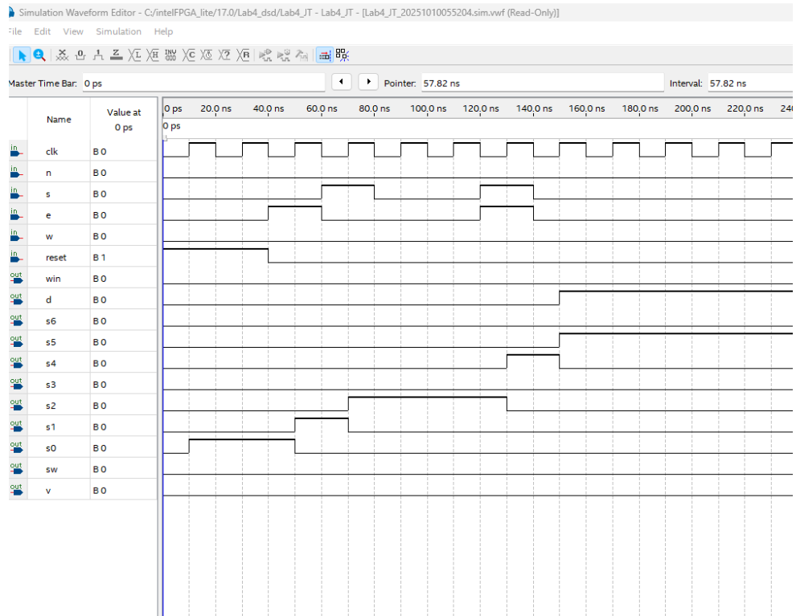

# Hierarchical FSM Adventure Game Controller (Cyclone IV FPGA)

<p align="left">
  
  
  
  
</p>


A modular, multi-tier digital finite state machine system designed in SystemVerilog, synthesized using Intel Quartus Prime, and physically verified on an Altera Cyclone IV E FPGA development board.

| Target Hardware | Verification Pipeline | Architecture Style |
| :--- | :--- | :--- |
| **Altera Cyclone IV E** | ModelSim / Quartus Vector Waveform | Hierarchical Multi-FSM |
| **Pushbutton Debouncing** | Physical Oscilloscope / Logic Testing | Synchronous RTL (`d_ff.sv`) |
| **Onboard LED Bus** | Board-Level Bench Demonstration | Explicit Item-State Latch |

---

## Architecture Overview

The system decomposes an interactive text/dungeon navigation game into decoupled hardware subsystems orchestrated by a top-level structural RTL module (`game.sv`):

* **Top-Level Orchestration (`game.sv`):** Integrates directional inputs, clock dividers, sequential primitives, and child state machines into a cohesive datapath.
* **Navigation FSM (`room.sv`):** Implements positional room-to-room transitions across the map based on directional player movement inputs (North, South, East, West).
* **Item Persistence Subsystem (`sword.sv`):** Governs inventory state latching, ensuring acquired items (such as the sword) persist across subsequent room transitions and trigger valid win conditions.
* **Custom Sequential Primitives (`d_ff.sv`):** Employs explicit edge-triggered **D flip-flop** register stages to synchronize asynchronous player inputs and preserve state stability.
* **Input Conditioning & Glitch Filtering:** Combinatorial logic designed to filter illegal simultaneous button presses and transient input spikes from mechanical switches.

```
              ┌─────────────────────────────────────┐
              │               game.sv               │
              │                                     │
Inputs ──────>│ [ Filter / Debounce ]               │
(Pushbuttons) │   │                                 │
              │   ├──> [ room.sv ] (Nav FSM) ──────>│──> Room LEDs
              │   │        │                        │
              │   └──> [ sword.sv ] (Item FSM) ────>│──> Win / Status LEDs
              │                                     │
Clock/Reset ─>│ [ d_ff.sv ] (State Registers)       │
              └─────────────────────────────────────┘
```
---

## Functional Verification & Waveform Analysis

The state machine transitions were functionally validated against both victory and failure paths using vector waveforms before flashing to silicon:

### Victory State Path (Sword Acquired)
<p align="center">
  
  <br>
  <em>Demonstrates input sequencing navigating room branches, latching the item flag in <code>sword.sv</code>, and triggering the victory state.</em>
</p>

### Failure / Game Over Path
<p align="center">
  
  <br>
  <em>Validates hazard detection and transition to the terminal defeat state when entering Dragon's Den without the sword.</em>
</p>

---

## Physical Hardware Bring-Up (Cyclone IV FPGA)

The design was compiled in Intel Quartus Prime, mapped to package pins via `FPGA_Dungeon_Game.qsf`, and verified on bench hardware using tactile pushbuttons for directional inputs, slide switches for system reset, and LEDs for room/sword status decoding.

### Hardware Walkthrough & Bench Test

https://github.com/user-attachments/assets/db463974-3549-4f10-8f24-018ba212ab43

*Hardware bench walkthrough demonstrating state transitions from Cave through Rapid River into Dragon's Den, highlighting unlatched sword flag death-state handling and hardware reset.*

---

## Repository Structure

- `game.sv` — Top-level structural SystemVerilog module
- `room.sv` — Navigation finite state machine module (Cave, Tunnel, River, Dragon's Den)
- `sword.sv` — Item acquisition and persistence state machine
- `d_ff.sv` — Custom D flip-flop sequential storage primitive
- `FPGA_Dungeon_Game.qpf` — Intel Quartus Prime project configuration file
- `FPGA_Dungeon_Game.qsf` — Physical pin assignments and device hardware constraints
- `Waveform.vwf` — Simulation vector waveform stimulus
- `media/waveform_win.png` — Functional simulation output for the victory branch
- `media/waveform_lose.png` — Functional simulation output for the defeat branch branch
