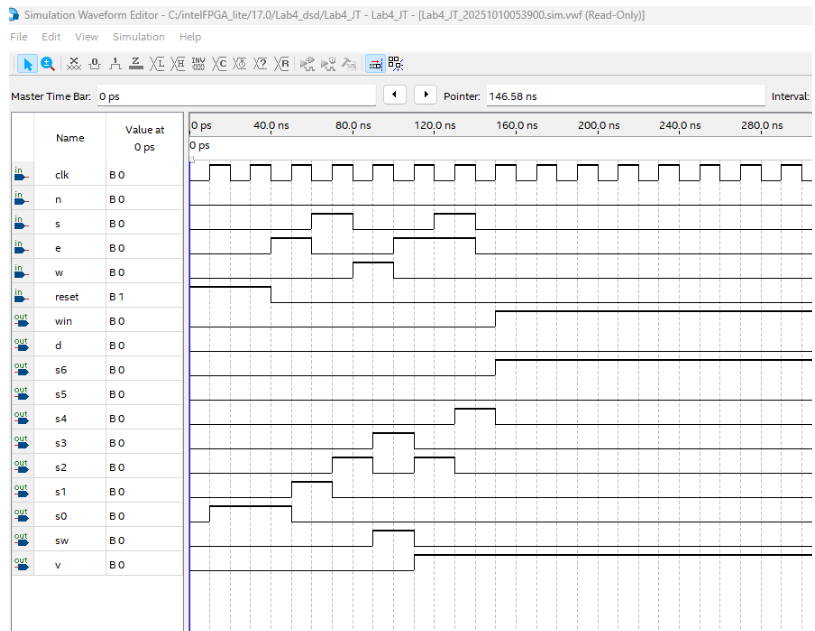

# Hierarchical FSM Adventure Game Controller (Cyclone IV FPGA)

A modular, multi-tier digital finite state machine system designed in SystemVerilog, synthesized using Intel Quartus Prime, and physically verified on an Altera Cyclone IV E FPGA development board.

---

## Architecture Overview

The system decomposes an interactive text/dungeon navigation game into decoupled hardware subsystems orchestrated by a top-level structural RTL module (`game.sv`):

* **Top-Level Orchestration (`game.sv`):** Integrates directional inputs, clock dividers, sequential primitives, and child state machines into a cohesive datapath.
* **Navigation FSM (`room.sv`):** Implements positional room-to-room transitions across the map based on directional player movement inputs (North, South, East, West).
* **Item Persistence Subsystem (`sword.sv`):** Governs inventory state latching, ensuring acquired items (such as the sword) persist across subsequent room transitions and trigger valid win conditions.
* **Custom Sequential Primitives (`d_ff.sv`):** Employs explicit edge-triggered D flip-flop register stages to synchronize asynchronous player inputs and preserve state stability.
* **Input Conditioning & Glitch Filtering:** Combinatorial logic designed to filter illegal simultaneous button presses and transient input spikes from mechanical switches.

```
                  ┌──────────────────────────────────────────────┐
                  │                 game.sv                      │
                  │                                              │
Player Inputs ───>│ [ Input Filtering / Debounce ]               │
(Pushbuttons)     │   │                                          │
                  │   ├──> [ room.sv ] (Navigation FSM) ────────>│──> Room Status LEDs
                  │   │        │                                 │
                  │   └──> [ sword.sv ] (Persistence FSM) ──────>│──> Item / Win Indicators
                  │                                              │
Clock / Reset ───>│ [ d_ff.sv ] (Sequential Synchronization)     │
                  └──────────────────────────────────────────────┘
```

---

## Functional Verification & Waveform Analysis

The state machine transitions were functionally validated against both victory and failure paths using vector waveforms before flashing to silicon:

### Victory State Path (Sword Acquired)

*Demonstrates input sequencing navigating room branches, latching the item flag in `sword.sv`, and triggering the victory state.*

### Failure / Game Over Path

*Validates hazard detection and transition to the terminal defeat state when entering Dragon's Den without the sword.*

---

## Physical Hardware Bring-Up (Cyclone IV FPGA)

The design was compiled in Intel Quartus Prime, mapped to package pins via `FPGA_Dungeon_Game.qsf`, and verified on bench hardware using tactile pushbuttons for directional inputs, slide switches for system reset, and LEDs for room/sword status decoding.

### Hardware Walkthrough & Bench Test

<!-- DRAG AND DROP YOUR .MP4 VIDEO FILE RIGHT HERE -->

*Hardware bench walkthrough demonstrating state transitions from Cave through Rapid River into Dragon's Den, highlighting unlatched sword flag death-state handling and hardware reset.*

---

## Repository Structure

* `game.sv` — Top-level structural SystemVerilog module
* `room.sv` — Navigation finite state machine module (Cave, Tunnel, River, Dragon's Den)
* `sword.sv` — Item acquisition and persistence state machine
* `d_ff.sv` — Custom D flip-flop sequential storage primitive
* `FPGA_Dungeon_Game.qpf` — Intel Quartus Prime project configuration file
* `FPGA_Dungeon_Game.qsf` — Physical pin assignments and device hardware constraints
* `Waveform.vwf` — Simulation vector waveform stimulus
* `waveform_win.png` — Functional simulation output for the victory branch
* `waveform_lose.png` — Functional simulation output for the defeat branch
